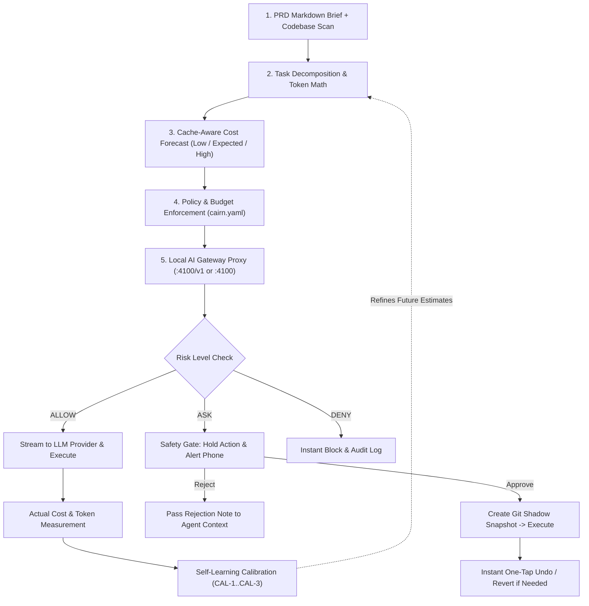
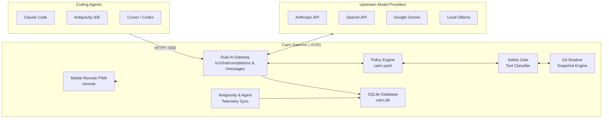

# Cairn — Project Architecture & Executive Brief

> **Architect & Lead Maintainer:** [Aryan Yadav](https://github.com/AryanYadav57) · [@AryanYadav57](https://github.com/AryanYadav57)  
> **Engineering & Design:** Crafted with precision by the **Cairn Studios** team  
> **Repository:** [https://github.com/AryanYadav57/cairn](https://github.com/AryanYadav57/cairn)  
> **System Version:** `v0.2.0` (Monorepo) · **Ecosystem:** Local-First AI Agent Control Plane

---

## 1. Executive Summary: What is Cairn?

**Cairn** is an open-source, local-first control plane, cost estimator, safe-action undo engine, and remote cockpit for AI coding agents.

### The Core Metaphor
A *cairn* is traditionally a stack of stones constructed along mountain trails to guide travelers through dense fog, steep terrain, and unmarked paths. In modern software development, autonomous coding agents (such as Antigravity, Claude Code, Cursor, Codex CLI, Aider, and OpenCode) navigate vast codebases across hundreds of automated steps and API calls. Without landmarks, developers face:
1. **Runaway Cost Surprises**: Blind token consumption with zero upfront forecasts or real-time cost throttling.
2. **Destructive Execution Risks**: Unchecked shell commands (`rm -rf`, dropping tables, git hard resets, accidental secret exposure).
3. **Execution Blindness**: Inability to monitor or steer agent sessions when away from the desktop terminal.
4. **Agent Fragmentation**: Disconnected telemetry across multiple agent harnesses operating on the same repository.

> [!IMPORTANT]
> **Key Distinction:** Cairn is **not** a code-writing agent. Cairn is the **supervisor, financial controller, safety net, and universal remote cockpit** for *any* coding agent.

---

## 2. What Cairn Does (The Closed-Loop Lifecycle)

Cairn wraps the entire lifecycle of agent-driven software development into a closed loop:



1. **Before Execution (Forecast)**: Scans your project directory and a Markdown PRD brief to decompose requirements into discrete tasks and forecast token consumption and dollar spend across 20+ frontier and local models.
2. **During Execution (Guard & Meter)**: Sits as a transparent local gateway proxying OpenAI-compatible (`/v1/chat/completions`) and Anthropic-compatible (`/v1/messages`) requests. It meters prompt caching hits, enforces hard spend caps, redacts credentials, and holds dangerous tools for human approval.
3. **At Dangerous Steps (Safety Net)**: Takes a zero-overhead Git Shadow snapshot before file modifications so any unwanted changes can be undone with a single tap.
4. **From Anywhere (Remote Control)**: Emits a real-time mobile Progressive Web App (PWA) over LAN to view live screen mirrors, inspect cost radars, approve held actions, and send steering prompts from your phone.
5. **After Execution (Learn)**: Feeds actual token usage back into empirical calibration multipliers (`retryFactor`, `cacheHitRatio`), making future forecasts progressively more accurate.

---

## 3. Key Features & Capabilities

### 3.1 Cache-Aware PRD Cost Estimator
- Decomposes Markdown product requirements into structured tasks.
- Applies codebase complexity factors (LOC, language count, test presence) and prompt caching multipliers (accounting for Anthropic 90% and Gemini 75-90% cache read discounts).
- Computes **P10 (Low)**, **P50 (Expected)**, and **P90 (High)** ranges.
- Runs dynamic **What-If Scenarios** across multiple frontier models (e.g. Gemini 4 Argon vs. Gemini 3.8 Flash vs. Claude 3.7 Sonnet vs. DeepSeek R1).

### 3.2 Dual-Protocol AI Gateway & Stream Interceptor
- **OpenAI Compatible Endpoint**: `http://localhost:4100/v1`
- **Anthropic Messages Endpoint**: `http://localhost:4100`
- **Task-Scoped Routing**: `http://localhost:4100/t/<task-id>/v1`
- Handles streaming Server-Sent Events (SSE) in real time.
- Categorizes tool actions into `read-only`, `low`, `medium`, `high`, and `critical` risk levels based on target path and command patterns.
- Redacts sensitive credentials (e.g., API keys, tokens, `.env` entries) before passing traces to logs.
- Detects prompt injection patterns and adversarial prompt tampering attempts.

### 3.3 Hierarchical Policy & Spend Engine (`cairn.yaml`)
- Configures multi-tier spending budgets:
  - `project`: Lifetime project budget ceiling (e.g. \$40.00).
  - `daily`: 24-hour spending velocity threshold (e.g. \$10.00).
  - `task`: Per-task budget cap (e.g. \$3.00).
- Configurable budget exhaustion modes:
  - `on_budget_80`: e.g. `fast_at_task_boundary` (auto-switch from frontier model to cost-efficient model).
  - `on_budget_100`: e.g. `wind_down_then_block` (gracefully completes current turn then halts further token burn).
- Supports declarative model aliases (`smart`, `fast`, `local`).

### 3.4 Git Shadow Snapshot & Instant Undo Engine
- Uses detached Git trees stored directly in the repository's `.git/` object store.
- **Zero Working-Tree Clutter**: Creates complete snapshots in < 50ms without polluting branches, commits, or stashes.
- Supports **Instant Atomic Revert**: Rolling back restores edited files and cleans untracked files generated during the agent's run.
- Generates unified visual diffs before approving or reverting changes.

### 3.5 Universal Mobile Remote Cockpit (PWA)
- Encrypted, zero-setup local web interface accessible from desktop (`http://localhost:4100`) or phone (`http://<LAN-IP>:4100/remote?token=<pairing-token>`).
- **Live IDE Window Mirror**: Captures high-efficiency desktop window frames (Win32 API on Windows, SVG vector fallback).
- **Interactive Control**: Tap-to-click on the live window image, one-tap keystroke shortcuts (`Approve (Enter)`, `Reject (Esc)`, `Stop (Ctrl+C)`, `Save (Ctrl+S)`).
- **Steering Input & Remote Responder**: Send prompts from your phone that are automatically answered with context-aware agent analysis, logged to `.cairn/remote_prompts.md`, and injected into IDE chat.
- **Profound-Inspired Visual System**: Elegant dark obsidian glassmorphism, 5-agent live consumption radar, and responsive mobile-first typography.

### 3.6 Cross-Agent Project Ledger
- Unified cost & token aggregator across disparate agent harnesses operating on the same codebase:
  - **Antigravity IDE**: Live session transcript parser (`transcript.jsonl`).
  - **Claude Code**: Project telemetry scanner (`~/.claude/projects/`).
  - **OpenCode**: SQLite session reader (`~/.local/share/opencode/opencode.db`).
  - **Codex CLI**: Local session reader (`~/.codex/sessions/`).
  - **Hermes Agent**: Multi-protocol runtime tracer.
- Displays combined project totals, per-agent breakdown, and session history in a dedicated tab.

### 3.7 Calibration & Self-Learning Moat
- Every completed task records empirical metrics: actual tokens spent, retry attempts, cache hit ratios.
- Calibrates Bayesian multipliers (`CAL-1`, `CAL-2`, `CAL-3`) so subsequent PRD estimates become increasingly personalized to your specific repository and coding patterns.

---

## 4. How It Works: Technical Architecture

### 4.1 Monorepo Structure

```
cairn/
├── main/
│   ├── packages/
│   │   ├── core/           # @cairn/core: Pure logic, policy schemas, pricing registry,
│   │   │                   # PRD cost estimator math, safety classification, and redactor.
│   │   ├── daemon/         # @cairn/daemon: Local gateway HTTP/WS server, SQLite db,
│   │   │                   # Git shadow engine, OS window bridge, telemetry sync, remote UI.
│   │   └── extension/      # cairn-vscode: Visual Studio Code & IDE bridge extension.
│   ├── ad/                 # Interactive product showcase & motion graphics preview server.
│   ├── video/              # Remotion programmatic launch video compositions.
│   ├── cairn.yaml          # Active project policy and budget configuration.
│   └── package.json        # Workspace definition & root scripts.
├── README.md               # Quickstart & public repository documentation.
└── PROJECT_BRIEF.md        # Complete architecture brief for developers & Claude.
```

### 4.2 Core Subsystems



---

## 5. Guide for Claude (How Claude Should Work with Cairn)

If you are **Claude** (running inside **Claude Code**, an IDE plugin, or via the Anthropic API), here are the key operational directives to know when working inside a Cairn-governed workspace:

### 5.1 Connecting Claude Code to Cairn's Gateway
When running Claude Code on this machine, route calls through Cairn to benefit from budget limits, spend logging, and approval gates:
```bash
ANTHROPIC_BASE_URL=http://localhost:4100 ANTHROPIC_API_KEY=cairn-local-key claude
```
*Note: Cairn will forward your requests upstream using the `ANTHROPIC_API_KEY` configured in Cairn's environment or request headers.*

### 5.2 Respecting the Safety Gate
- Cairn intercepts tool calls (such as file writes or shell commands).
- If an action matches an `ask` pattern in [`main/cairn.yaml`](file:///e:/class%20related/Cairn%20Studios/cairn1/main/cairn.yaml), Cairn pauses the stream and creates a Git Shadow Snapshot.
- The human operator reviews the action on their phone or desktop and clicks **Approve** or **Reject**.
- If rejected, Cairn returns a structured rejection reason with an optional operator note. When Claude receives a rejection, Claude must **respect the decision** and explain an alternative, non-destructive path.

### 5.3 Task Attribution
Claude can attribute its token burn to a specific PRD task by sending the header:
```http
X-Cairn-Task: <task-id>
```
Or by connecting through task-scoped URLs:
```http
http://localhost:4100/t/<task-id>/v1
```

### 5.4 Respecting Budgets
- If the project hits 80% budget consumption, Cairn signals a preference for cost-efficient models (e.g. `fast` alias: Gemini 3.8 Flash or Claude 3.5 Haiku).
- If the project hits 100% budget cap, Cairn enforces `wind_down_then_block`. Claude should finalize immediate code edits, commit clean work, and avoid initiating new large-scale exploratory tasks.

---

## 6. CLI Commands & Developer Cheatsheet

All commands should be executed from the `main/` directory:

| Command | Action |
| --- | --- |
| `cd main && npm run build` | Compiles all TypeScript workspaces (`@cairn/core`, `@cairn/daemon`, `cairn-vscode`). |
| `cd main && npm test` | Runs the full 12-suite unit and integration test suite across core and daemon. |
| `cd main && npm start` | Launches the Cairn Gateway, Telemetry Sync, and Dashboard on port `4100`. |
| `cd main && npm run preview` | Starts the interactive HTML product ad and motion graphics preview server on port `3000`. |
| `cd main && npm run estimate` | Runs a CLI cost estimation against the project PRD. |
| `cd main && npm run video:render` | Programmatically renders the 60fps MP4 product launch video with Remotion. |

---

## 7. Configuration Specification (`cairn.yaml`)

The control plane policy is configured declaratively in [`main/cairn.yaml`](file:///e:/class%20related/Cairn%20Studios/cairn1/main/cairn.yaml):

```yaml
project: cairn-workspace

budgets:
  project:
    usd: 40.00
  daily:
    usd: 10.00
  task:
    usd: 3.00
  exhaustion_mode: wind_down

routing:
  default: smart
  on_budget_80: fast_at_task_boundary
  on_budget_100: wind_down_then_block

aliases:
  smart: google/gemini-4-argon
  fast: google/gemini-3.8-flash
  local: ollama/qwen2.5-coder:14b

actions:
  allow:
    - "read_file:*"
    - "search_web:*"
    - "git_status:*"
  ask:
    - "write_file:*.ts"
    - "write_file:*.js"
    - "run_command:*"
  deny:
    - "run_command:rm -rf *"
    - "run_command:*:drop database*"
    - "write_file:.env*"

remote:
  enabled: true
  require_biometric_for_high_risk: true
  session_timeout_minutes: 120
```

---

## 8. Author & Team Credits

- **Creator & Lead Architect:** [Aryan Yadav](https://github.com/AryanYadav57)  
- **GitHub Profile:** [https://github.com/AryanYadav57](https://github.com/AryanYadav57)  
- **Studio & Design System:** Developed under the vision and subtle aesthetic standards of **Cairn Studios**  
- **License:** MIT License — Open Source Community Edition
